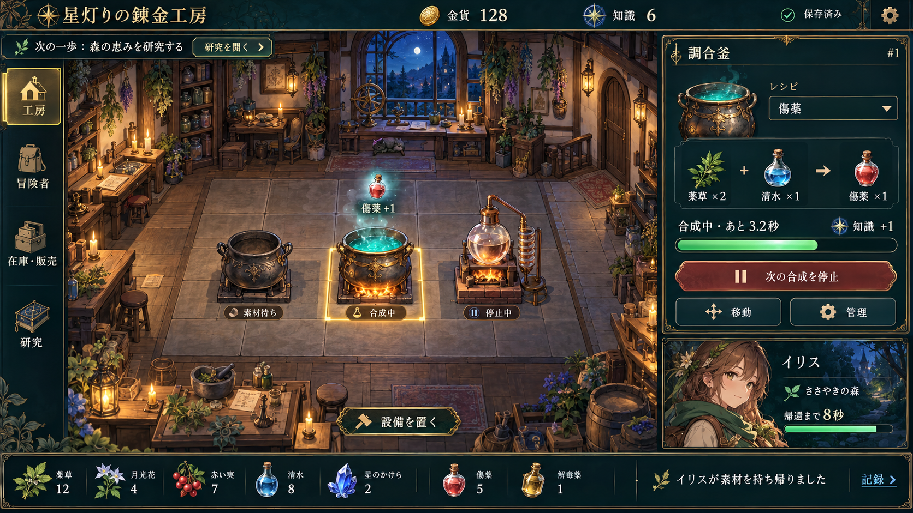

# Solへの引き継ぎ指示書 — UI改善の実装

更新日: 2026-10-24（Asia/Tokyo）

## この指示書の目的

別セッションのSolが、以下の採用済み方針に沿って「星灯りの錬金工房」のUI改善を実装・検証できるようにする。提案段階は完了している。次のセッションでは計画の再提出だけで終わらず、動くゲーム画面を作ること。

ユーザーの最新指示は「このイメージ図で大筋はOKだが、キャラクター絵だけは生成AIっぽさを減らすために細かい書き込みを減らしたりする工夫をしてほしい。その方向でSolに別セッションで作業を進めてもらうための指示書を書いて、github上のレポジトリにこれまでの作業と合わせてPushして」。

**画面構成と工房の雰囲気は採用。人物の描き込みは減らして作り直す。** この指示書の作成セッションではUI実装や別セッションの起動は行っていない。

## 最初に読むもの

1. [AGENTS.md](../AGENTS.md): Cloud作業、承認、Git、保存・互換性のルール。
2. [PROGRESS.md](PROGRESS.md)と[PLAN.md](PLAN.md): 現在地と優先順。
3. 本指示書と[採用コンセプト画像](assets/ui-concept-2026-10-24.png)。画像は実際に開いて確認する。
4. [UI改善レポート](UI-REPORT-2026-10-24.md): 問題の実測、画面構成、実装境界、品質基準。
5. [SPEC.md](SPEC.md)、[ARCHITECTURE.md](ARCHITECTURE.md)、[DEPLOYMENT.md](DEPLOYMENT.md): 既存ゲームと配信の契約。

デザイン判断は「ユーザーの最新指示 → 本指示書 → UIレポート → 旧MVPの見た目の記述」の順に扱う。ゲームの経済・時間・保存仕様は現行コードとSPECを維持する。旧SPECの「文字/記号だけ」「モバイルでは全部縦積み」はMVP時の方針であり、今回のUI改修を妨げる制約ではない。

## 採用した画面の方向性

- **中央**: 夜の青緑と炉の暖色が対照的な工房。木、石、真鍮、ガラスで作品の雰囲気を作る。設備と背景装飾を区別できること。
- **上部**: タイトル、金貨、知識、保存状態、設定への入口。次の行動は短い目標バーで示す。
- **左**: 工房／冒険者／在庫・販売／研究のナビゲーション。
- **右**: 選択設備のレシピ、必要素材、進捗、開始・停止、移動・管理。冒険者の状況も簡潔に把握できる。
- **下部**: 在庫の要約と直近の結果通知。全量販売などの誤操作を招かない配置にする。
- **モバイル**: 同じ情報の優先順位を、下部ナビゲーションと設備詳細シートへ組み替える。デスクトップ画像の全体縮小にしない。

工房の広さ、読みやすい操作、視線誘導を優先する。画面の隅々へ同じ密度の金装飾を足さず、重要な選択・ボタン・数値が目立つよう調整する。

### コンセプト画像を仕様としてコピーしない箇所

- 画像内の「月光花」「赤い実」「星のかけら」「解毒薬」は現行アイテムではない。表示は既存6種（薬草、清水、魔晶片、傷薬、薬草エキス、魔力薬）へ合わせる。
- 配置は現行の直交6列×4行と1マス設備を維持する。画像の遠近や床線をそのまま座標・当たり判定にしない。
- 画像では「停止中」の蒸留器にも強い炉光がある。実装では稼働状態と演出を一致させる。
- イリスの帰還通知と探索中表示、数量、残時間等はイメージ上の例。実際のゲーム状態から描画する。
- 背景に猫等の装飾が見えても、新しいゲーム機能を意味しない。
- 文字、ボタン、バー、数値、設備位置を1枚絵に焼き込まない。コンセプト画像を背景に貼り、透明ボタンを重ねて完成扱いにしない。

## 最重要: キャラクター絵の修正方針

対象はイリスとローワンの人物肖像。ユーザーの「生成AIっぽさを減らす」という要望を、**意味のある線と面に絞り、意図の明確な人物デザインにする**方針へ落とし込む。工房の描き込みまで一律に削る要求ではない。

| 要素 | 目指す描き方 | 避けるもの |
| --- | --- | --- |
| 髪 | 前髪・側頭部・後ろ髪など大きな束とシルエットで構成 | 全域の極細毛、意味のない交差、過剰なハイライト |
| 顔 | 読める目・眉・口、整理した鼻と輪郭。表情に合う自然な左右差 | ガラス状の巨大な瞳、過剰なまつ毛、均一な人形顔 |
| 陰影 | 基本色＋影を中心に2〜3段階。光源は一つを基本にする | 肌全体の艶、細かい多重反射、立体感を盛るためだけのグラデーション |
| 衣装 | 大きな布面と必要な折り目。役割が伝わる道具を少数 | 微細な刺繍、無数の留め具、用途不明のベルトや装飾 |
| 線と質感 | 主要な輪郭を読みやすく、内部の線は必要な場所に限定 | 全面ノイズ、過剰なブラシ跡、ぼかしによる省略 |
| 色 | 共通パレットの落ち着いた色面と少量のアクセント | 顔と背景を同時に強く発光させる色、過剰な彩度 |
| 構図 | 胸上・肩上程度。顔と職業の特徴が小サイズで読める | 不要な手指や小物で画面を埋める構図 |

イリスは参考画像の茶系の髪、緑の外套、採集家としての親しみやすさを出発点にする。葉や道具は少数に整理する。ローワンは遺跡を歩く旅人として、髪型・外套の形・色面で明確に差を付ける。二人の頭身、目の処理、線の太さ、影の段数、光源は共通にする。既存ゲームにない職業ボーナスを肖像の説明へ追加しない。

単に画像を縮小・ぼかす、雑に線を消す、極端なデフォルメやピクセル絵へ変えることを解決策にしない。既存人物絵の細密さを継承する必要はないが、世界観との馴染みとキャラクターの魅力は残す。

### 人物制作の手順と合格条件

1. まずイリス1名を、明確な輪郭と簡潔な陰影で制作する。高密度の原画を大量に生成する前に画風を決める。
2. 64px、96px、192px程度の表示と、実際の冒険者カードで見比べる。髪型、表情、顔と服の境界が読めること。
3. 原画を拡大して、髪・服・留め具・目鼻の構造に不自然な接続がないか確認する。不要な装飾を追加して欠点を隠さない。
4. 採用したイリスを共通基準にローワンを制作し、二人を横に並べて統一感と識別性を確認する。
5. 最終報告では変更前のコンセプトと、描き込みを抑えた人物を比較できるよう提示する。各工程の通常判断で承認待ちにせず、要望に沿う案を選んで進める。

画像生成を使う場合の指示例:

> オリジナルのファンタジー工房ゲーム用の成人採集家イリスの肩上肖像。茶色の髪と深緑の外套、穏やかで自信のある表情。大きな髪の束、簡潔で明瞭な輪郭線、基本色と一段の影を中心にした少数の色面。服の折り目と留め具は必要なものだけ。細い毛の描き込み、肌の艶、複雑な瞳の反射、刺繍、微細な装飾、全面テクスチャは入れない。背景は透過。96px表示でも髪型と表情を判別できる構図。文字とロゴなし。

これは実装担当用の推奨指示であり、修正版の人物画像はまだ生成していない。生成物の制作元は記録し、人が手描きしたと偽って扱わない。画風の整理が品質判断の対象である。

## 実装の範囲と進め方

最終Goalは、採用コンセプトの雰囲気と読みやすさを備え、既存のゲーム全機能を実際に操作できるUI。まず一巡を完成させ、次に全状態へ広げる。レポートのUI-1〜UI-4を以下の順で実施する。

1. **操作の骨格**: 常設HUD、画面切替、選択設備の詳細、短い初回案内、文字・タップ領域。デスクトップで工房と開始/停止を同時に見せる。モバイルに下部ナビと詳細シートを用意する。
2. **一巡の見た目**: 工房背景、釜、簡潔な人物画のイリス、薬草・清水・傷薬。既存の雇用→派遣→製造→販売→研究をつなぎ、短い完成・帰還・販売演出を加える。
3. **全機能へ展開**: 蒸留器、ローワン、残りの素材、研究と探索先、移動・交換、満杯配置、停止予約、素材不足。素材不足から入手先への導線、研究前提と解放内容を分かりやすくする。
4. **仕上げ**: 通知の集約、演出軽減、設定とヘルプ、入力・フォーカス、読み込みと性能。音を追加する場合はミュートと音量を備える。

各段階で画面を動かして確認し、意味のまとまりでcommitする。途中でセッションを終える場合は、完了した段階と未完了を明記し、モックだけをUI改善完了と報告しない。

### 維持する契約

- React + TypeScript + Viteを活用する。新しいゲームエンジンへの移行や依存関係の大幅更新は前提にしない。
- `GameState`と既存エンジンを正本にし、UIが通貨・在庫・報酬・時間を別計算しない。画面切替で`useGame`を複数起動・再作成しない。
- Web Locks、待機タブ、保存失敗・破損復旧、schemaVersion 2、旧v1バックアップを維持する。
- 進行中バッチと派遣は開始時条件を保持する。次バッチ停止と即座の中断を混同しない。
- 非表示中・オフラインの時間は加算しない。画面内のタブ切替でゲーム全体を停止させない。
- 数量指定販売、素材確保数、自動販売、隣接効果、収納、工房拡張、戦闘、追加レシピ等は今回のUI実装の必須条件にしない。既存の全量販売には数量・売上の事前表示を付けられる。
- 画像は背景・設備・人物・アイコンを分離する。UI部品はDOM等で描画し、アクセシブルな操作を保つ。配置座標・セーブへアートの都合を持ち込まない。
- 画像パスはVite importまたは`BASE_URL`に対応させる。GitHub Pagesの`/Alcemy-Sim1/`を壊さない。
- 構造化イベント等で演出を接続し、表示ログの日本語解析で駆動しない。再読込で過去の通知や報酬演出を再生しない。

## アセットとGPT-Image

GPT-Imageの使用はユーザーが許可済み。利用可能なら、上の人物制作基準と参考画像を用いて進める。画像編集では対象を実際に開いてから、利用可能な画像生成・編集ツールの手順に従う。

画像生成ツールが別セッションにない場合でも、レイアウトや入力・状態表示の実装は進められる。単なる記号アイコンへの置換や既存の細密な肖像を最終成果として済ませず、人物素材が未完ならその状態を記録する。新たな課金サービスの契約や認証情報の要求は不要。

参考PNGは`docs/assets/`の設計資料であり、製品アセットではない。実装用のアセットは適切な解像度・形式・透過・圧縮で配置し、原画との対応、生成指示の要点、使用条件を記録する。単純な機能アイコンはSVG、泡・発光・進捗はコード側の表現を優先する。

## 検証と納品条件

既存の最新検証は、UIレポート作成時点でVitest 46件、通常パスE2E 24件、PagesパスE2E 24件、合計94件成功。これはUI改修後の結果ではない。

- `npm run check`を実行し、既存の経済・保存・復旧・設備交換の検証を保つ。ナビ変更に伴いE2Eを実際のユーザー操作へ更新する。非表示要素への強制クリック等で見かけ上通さない。
- 1440×900と1366×768で工房と主要操作の同時表示。390×844と320×740で全機能へ到達し、ページ全体の横はみ出しがないこと。
- 重要な補足14px以上、本文16px基準、主要タッチ対象44×44 CSS px以上を目標とする。文字拡大時の再配置も確認する。
- キーボードだけで一巡・配置・移動・取消が可能。矢印で設備マスを移動、Enter決定、Escape取消、シートを閉じた後のフォーカス復帰を確認する。
- 新規、稼働中、素材不足、停止予約、研究可能/前提不足/研究済み、満杯工房、保存失敗、待機タブ、破損復旧、画像読込失敗を確認する。
- 24設備の同時稼働で、操作反応と通知量を確認する。処理時間・転送量を計測し、未計測の性能を達成済みと書かない。
- コンセプトと実画面を比較し、工房の主役性、文字の読みやすさ、人物の簡潔な描き方を目視で確認する。スクリーンショット等の検証成果物はAGENTSのルールに従って扱う。
- `PROGRESS.md`、`PLAN.md`、実際の仕様・構成に変更があれば関連文書を更新。検証結果、既知の制約、素材の未完了、次の作業を記録する。
- 削除以外のGit操作とCloud内で完結するコマンドは事前承認済み。差分を確認してcommit・通常のpushを行う。mainへアプリケーション変更をpushすると既存ActionsでPages公開が走るため、必須検証後に行い、配信の成功/未確認を区別して報告する。force pushや既存変更の破棄はしない。

## 別セッションの開始プロンプト

以下をSolの新しいセッションへ渡せば開始できる。

> `TomofumiYabu/Alcemy-Sim1` の最新mainを対象に、`AGENTS.md`、`docs/PROGRESS.md`、`docs/PLAN.md`、`docs/SOL-UI-HANDOFF.md`を読んでUI改善を実装してください。`docs/assets/ui-concept-2026-10-24.png`の画面全体の方向性は採用済みですが、キャラクター絵は髪・陰影・衣装の描き込みを減らし、明確な輪郭と少数の色面で作り直してください。ゲームの既存機能と保存互換性を保ち、UIの骨格→一巡の品質→全機能→仕上げの順に進め、実ブラウザー確認と`npm run check`、文書更新、commit・pushまで行ってください。GPT-Imageの使用、および削除以外のGit操作とこのCloud環境内で完結するコマンドは許可済みです。通常の判断で確認待ちにせず進め、完了範囲と残作業を明確に報告してください。
